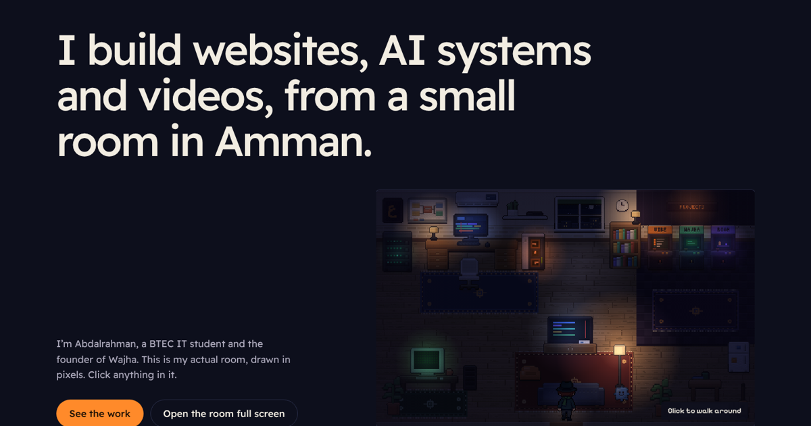

# Abdalrahman Amoudi

My portfolio. I build websites, AI systems and videos from a small room in Amman, and the site opens on that room: a live, playable pixel version of it, right in the hero.

Live: https://abdalrahman-room.vercel.app

## What's on the page

- **The room:** my old portfolio game, embedded in the hero. Walk with WASD or the arrows, and click things to read about them. The site's day/night switch also changes the room's lighting. It starts on day or night depending on the time in Amman.
- **Selected work:** Vibe Todos, Wajha, peak, Dumbbell Gym and Catppuccin New Tab. Each project opens into a short case study, and every case study has its own link (for example `/#vibe`).
- **What I do:** video, AI, networks, and web, in the order I got into them.
- **Motion:** two reels, drawn and sound-designed in code.
- **How a project goes, about, contact.**
- **Languages:** English and Arabic, with full right-to-left layout.

## How it's built

There's no framework and no build step: one HTML file, one stylesheet and one script.

- `index.html`: the page.
- `assets/site.css`: the layout and both themes, day (`data-time="day"`) and night.
- `assets/site.js`: all the content in English and Arabic (projects, crafts, steps), and the rendering, carousel, case studies, reels and room messaging.
- `room/index.html`: the pixel room. On its own it's the full game. With `?embed=1` it hides its toolbar, fits the whole room in the frame, and takes day/night and language from the page through `postMessage`.
- `room/src/`: the room's readable source.
- `assets/fonts/`: Readex Pro (Latin and Arabic) and Pixelify Sans, both SIL OFL.

To run it locally, serve the folder with any static server (for example `python3 -m http.server`). The room embed needs the page and the room on the same origin, so opening the file directly won't work.
